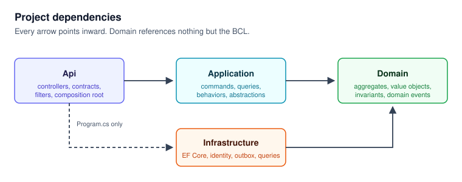
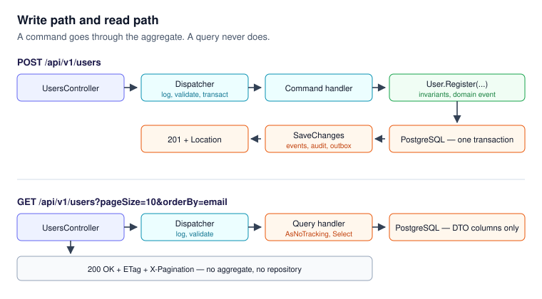

# Architecture

## Layers



Four projects, with every dependency pointing inward (ADR 0001).

| Project | Holds | References |
|---|---|---|
| `Domain` | Aggregates, value objects, enumerations, domain events, repository interfaces, `Result` | Nothing but the BCL |
| `Application` | Commands, queries, handlers, validators, pipeline behaviors, abstractions Infrastructure implements | `Domain` |
| `Infrastructure` | `AppDbContext`, configurations, repositories, interceptors, Argon2, JWT, outbox, query handlers | `Domain`, `Application` |
| `Api` | Controllers, HTTP contracts, mappers, filters, error handling, composition root | `Application`, and `Infrastructure` only in `Program.cs` and `Extensions/` |

The rule is checked mechanically on every pull request: `Domain` may hold no
`PackageReference`, `Application` no EF Core or ASP.NET using, and no
controller may name an Infrastructure type.

## The two request paths



**Writes** go through the domain. The controller maps the request to a command,
the dispatcher wraps the handler in logging, validation and a transaction, and
the handler orchestrates. Business rules live in the aggregate, with two
exceptions that need something the aggregate cannot see: refusing to lock your
own account needs the caller, and a unique email needs the database, so both
are checked in the handler. The aggregate enforces its invariants and raises
domain events, which are dispatched *before* commit,
inside the same transaction, so a failing handler rolls the write back (ADR
0007). Anything that must leave the service is written to the outbox in that
same transaction and published afterwards (ADR 0008).

**Reads** do not. A query handler reads `AppDbContext` with `AsNoTracking` and
projects straight into a DTO, so the database returns only the columns the DTO
needs — the password hash is never selected on a read. There is no aggregate
and no repository on this path (ADR 0016).

## Middleware order

```
ForwardedHeaders          → the real scheme and caller address behind a proxy
CorrelationId             → one id per request, in every log line and the response
Serilog request logging
IExceptionHandler chain   → domain → concurrency → bad request → global, all to problem details
Status code pages         → problem details for a 404, 405 or 415 with no body
Security headers
HSTS + HTTPS redirection  → production only
Routing
CORS                      → preflight answered before any auth challenge
Authentication            → before the limiter: read/write policies key on user id
Rate limiter
Authorization
Endpoints                 → controllers, health, OpenAPI, Scalar
```

The order is not stylistic. Rate limiting sits after routing because
per-endpoint policies need the resolved endpoint, and after authentication
because two of the three policies partition by user id.

## Model types

| Group | Lives in | Examples | Crosses a boundary? |
|---|---|---|---|
| HTTP contracts | `Api` | `RegisterUserRequest`, `UserResponse`, `V2.UserResponse` | Serialized to the client. Versioned. |
| Application messages | `Application` | `RegisterUserCommand`, `GetUsersQuery`, `UserDto`, `PagedList<T>` | Never serialized. |
| Domain model | `Domain` | `User`, `Email`, `UserStatus` | Also the persistence model (ADR 0004). |
| Infrastructure types | `Infrastructure` | `OutboxMessage`, `AuditLogEntry`, `UserConfiguration` | Never leave the layer. |

Contracts are separate from commands on purpose (ADR 0011), and M5 collected
the payoff: `GET /api/v2/users/{id}` returns a single `displayName` instead of
two name fields, and neither the query, the read model nor the aggregate moved.

## Schema

```
users              id uuid PK, email citext UNIQUE, password_hash text,
                   name_first varchar(100), name_last varchar(100), status_id int,
                   created_at_utc timestamptz, updated_at_utc timestamptz,
                   xmin (concurrency, ADR 0021)
roles              id uuid PK, name varchar(100) UNIQUE
permissions        id uuid PK, code varchar(100) UNIQUE
user_roles         id uuid PK, user_id FK, role_id FK, assigned_at_utc, UNIQUE (user_id, role_id)
role_permissions   id uuid PK, role_id FK, permission_id FK, UNIQUE (role_id, permission_id)
refresh_tokens     id uuid PK, user_id FK, token_hash varchar(64) UNIQUE,
                   created_at_utc, expires_at_utc, revoked_at_utc,
                   replaced_by_id uuid, xmin (concurrency)
audit_log          id bigint identity PK, actor_id uuid, action varchar(20),
                   entity varchar(100), entity_id varchar(200), payload jsonb,
                   occurred_at_utc timestamptz
outbox_messages    id uuid PK, type varchar(500), payload jsonb, occurred_on_utc,
                   processed_on_utc, next_attempt_on_utc, attempts int,
                   error varchar(2000)
idempotency_keys   PK (caller_id uuid, operation varchar(200), key varchar(255)),
                   request_hash varchar(64), status varchar(20), response_status int,
                   response_location varchar(2000), response_content_type varchar(200),
                   response_body bytea, created_at_utc, completed_at_utc,
                   expires_at_utc, INDEX (expires_at_utc) (ADR 0023)
login_failures     email_hash varchar(64) PK, consecutive_failures int,
                   last_failure_at_utc timestamptz, blocked_until_utc timestamptz,
                   INDEX (last_failure_at_utc) (ADR 0024)
```

Aggregate boundaries are wider than the foreign keys suggest:

- `User` = `users` + `user_roles`. A row in `user_roles` changes only through
  `user.AssignRole(roleId)`.
- `Role` = `roles` + `role_permissions`.
- `RefreshToken` is its own aggregate: it rotates on every refresh, and putting
  it inside `User` would load and lock the whole user on every token exchange.
- `audit_log`, `outbox_messages`, `idempotency_keys` and `login_failures` are
  infrastructure, not domain. The last two have no foreign key to `users`:
  `login_failures` is keyed by a hash of the email, so it holds a row for an
  address that has no account too.

References between aggregates are foreign keys, never navigation properties —
`UserRole` holds a `RoleId`, not a `Role`. That single rule is what keeps the
aggregates from collapsing into one graph, and a reflection test in the domain
test project enforces it.

Schema choices worth naming: `citext` for email gives case-insensitive
uniqueness without a functional index; `status_id` is an `int` because
`UserStatus` is an enumeration class rather than a C# `enum` (ADR 0006);
`replaced_by_id` records the rotation chain, which is what makes reuse
detection possible; and `audit_log` carries a trigger that refuses `UPDATE` and
`DELETE`, because the application connects as the owner of the table and a
`REVOKE` would not bind it.

## Security

- Argon2id password hashing, parameters from configuration, stored PHC-style.
- HS256 access tokens, fifteen minutes, zero clock skew. Claims: `sub`,
  `email`, `jti`, one `permission` per code — no role name reaches the token.
- Refresh tokens are stored only as SHA-256 hashes, rotate on every use, and
  a replayed token revokes every active token for that account (ADR 0009).
- Authorization names a permission, never a role (ADR 0010). No bare
  `[Authorize]` exists in the project.
- Every write to users and roles is recorded in the append-only audit log, with
  its actor when there is one (a system write has none); payloads
  record which fields changed, never their values. A role assignment also
  names its user and role, and `GET /api/v1/users/{id}/history` reads a user's
  rows back (ADR 0025).

## Extending

Where a change of each common kind goes, in the order it is usually written.
Paths are from the repository root; the existing type named in each step is the
one to copy.

**A new permission.**

1. Add the code to `src/UserManagementAPI.Domain/Roles/PermissionCodes.cs` as a
   constant, and to `All`. Add it to `ReadOnly` too if a Member should hold it.
2. Nothing else registers it. `DatabaseSeeder`
   (`src/UserManagementAPI.Infrastructure/Persistence/Seed/DatabaseSeeder.cs`)
   inserts every code in `All` that is missing and grants it to Administrator
   (all codes) and Member (`ReadOnly`) on its next run, including to roles
   that already exist. Permissions are seed data, not a migration.
3. Gate the endpoint with `[HasPermission(PermissionCodes.YourCode)]`;
   `PermissionPolicyProvider` builds the policy from the name.
4. A token carries the permissions held when it was issued, so a caller sees
   the new one after their next login or refresh. In production the seeder
   runs only when `Database:SeedOnStartup` is switched on, so a deployment that
   adds a code needs one seeded start.
5. `GetRoles_ListsTheSeededRoles_WithTheirPermissionCodes` in
   `tests/UserManagementAPI.IntegrationTests/Functional/ReadEndpointTests.cs`
   expects Administrator to hold `PermissionCodes.All` and lists Member's
   codes by name, so a code added to `ReadOnly` is added there too. Add a
   functional test that the endpoint answers 403 without the code, as
   `PermissionGateTests` does.

**A new command and its endpoint.** `LockUser` and `UpdateUser` are the
models.

1. The rule goes in the aggregate first: a method on
   `src/UserManagementAPI.Domain/Users/User.cs` that takes `utcNow` and
   returns `Result`, with its errors as `static readonly Error` fields next to
   the others, each with an `ErrorType`. Domain tests in
   `tests/UserManagementAPI.Domain.UnitTests/Users/`.
2. In `src/UserManagementAPI.Application/Users/Commands/<Name>/`: the command
   (`<Name>Command : ICommand`, or `ICommand<T>` when it returns a value), its
   `<Name>CommandHandler`, and its `<Name>CommandValidator`. Handlers and
   validators are found by assembly scanning
   (`src/UserManagementAPI.Application/DependencyInjection.cs`), so nothing is
   registered by hand; `TransactionBehavior` wraps the handler. The handler
   reads `TimeProvider` once and passes the time down.
3. Handler tests in
   `tests/UserManagementAPI.Application.UnitTests/Users/Commands/`, with
   `TestClock` and faked repositories.
4. If the endpoint takes a body, a request contract in
   `src/UserManagementAPI.Api/Contracts/V1/` and a `ToCommand` method on
   `src/UserManagementAPI.Api/Mapping/UserRequestMapper.cs`; Mapperly
   generates it and matches route values to the command by name (ADR 0011,
   ADR 0014).
5. The action on `src/UserManagementAPI.Api/Controllers/V1/UsersController.cs`:
   `[HasPermission]`, `[EnableRateLimiting(RateLimitingExtensions.WritePolicy)]`,
   `If-Match` read through `IfMatchHeader` for a write to a user, a
   `[ProducesResponseType]` for every status it can answer, and a route name in
   `src/UserManagementAPI.Api/Hateoas/RouteNames.cs` if a link points at it.
   The action dispatches with `dispatcher.SendAsync` and turns a failure into
   problem details with `ToProblem(HttpContext)`.
6. A new error code goes into the table in
   `tests/UserManagementAPI.IntegrationTests/Errors/ErrorMappingTests.cs`,
   whose reflection test fails until it is listed. Functional tests over real HTTP go in
   `tests/UserManagementAPI.IntegrationTests/Functional/`, and
   `OpenApiDocumentTests` covers the document.

**A new query.** `GetUserHistory` is the model.

1. The query and its DTO in `Application`:
   `src/UserManagementAPI.Application/Users/Queries/<Name>/<Name>Query.cs`
   (`IQuery<TResponse>`) and a record in
   `src/UserManagementAPI.Application/Users/Dtos/`. A validator beside the
   query if it takes parameters, as `GetUsersQueryValidator` does.
2. The handler in Infrastructure (ADR 0016):
   `src/UserManagementAPI.Infrastructure/Queries/Users/<Name>QueryHandler.cs`,
   `internal sealed`, projecting from `AppDbContext` with `AsNoTracking`
   straight into the DTO. `AddQueryHandlers` in
   `src/UserManagementAPI.Infrastructure/DependencyInjection.cs` finds it by
   scanning.
3. A response contract in `src/UserManagementAPI.Api/Contracts/V1/` and a
   `ToResponse` method on `src/UserManagementAPI.Api/Mapping/UserResponseMapper.cs`.
4. A `GET` (and `HEAD`) action with `[HasPermission(PermissionCodes.UsersRead)]`
   and `[ETagFilter]`, dispatching with `dispatcher.QueryAsync`.
5. Tests against PostgreSQL: the projection in
   `tests/UserManagementAPI.IntegrationTests/Queries/`, the endpoint in
   `tests/UserManagementAPI.IntegrationTests/Functional/`, as
   `UserHistoryTests` does.

**A real outbox publisher.** Today `LoggingOutboxPublisher`
(`src/UserManagementAPI.Infrastructure/Outbox/LoggingOutboxPublisher.cs`) only
writes a log line (ADR 0008).

1. Implement `IOutboxPublisher`
   (`src/UserManagementAPI.Infrastructure/Outbox/IOutboxPublisher.cs`) in
   `src/UserManagementAPI.Infrastructure/Outbox/`. `PublishAsync` receives the
   `OutboxMessage` with its `Type` and `jsonb` `Payload`; returning marks the
   message processed, throwing schedules a retry with backoff.
2. Replace the one registration in
   `src/UserManagementAPI.Infrastructure/DependencyInjection.cs`:
   `services.AddSingleton<IOutboxPublisher, LoggingOutboxPublisher>();`. It is
   a singleton, so the publisher must be safe to share, or the registration's
   lifetime changes with it.
3. Its options go in configuration and its secrets in user secrets or the
   environment, never in `appsettings.json`.
4. Delivery is at least once, and the batch's row locks are held while it
   publishes (ADR 0008, amended by
   [#120](https://github.com/aleksa-dragnic/UserManagementAPI/pull/120)):
   consumers must be idempotent, and a slow transport holds its batch that
   long. `OutboxTests` in
   `tests/UserManagementAPI.IntegrationTests/Outbox/` shows how the processor
   is tested with a substitute publisher.
